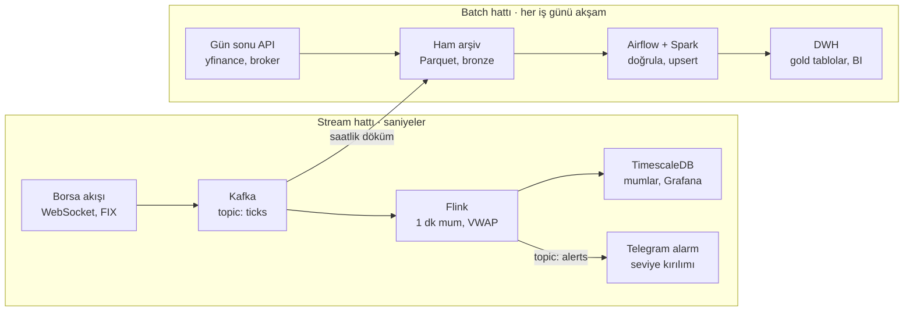

# Batch ve Stream Veri İşleme

Veriyi işlemenin iki temel yolu vardır: biriktirip belirli aralıklarla toplu işlemek (**batch**) ya da her olay geldiği anda işlemek (**stream**). Seçim, "sonuca ne kadar hızlı ihtiyacım var?" sorusunun cevabına göre yapılır; teknoloji seçimi bundan sonra gelir.

Bu rehber iki yaklaşımı kavram düzeyinde anlatır, gerekli teknoloji katmanlarını (kuyruk, işleme motoru, DWH, orkestrasyon) sıralar ve hepsini aynı örnek üzerinde somutlaştırır: **hisse senedi fiyat verisi**. Aynı veri, gün sonu raporlama için batch, anlık alarm için stream olarak işlenir.

## İçindekiler

| # | Bölüm | Konu |
| --- | --- | --- |
| 1 | [Batch ve stream nedir](docs/01-batch-ve-stream.md) | Tanımlar, özellikler, karşılaştırma tablosu |
| 2 | [Temel kavramlar](docs/02-temel-kavramlar.md) | Event time, window, watermark, offset, exactly-once… |
| 3 | [Teknoloji katmanları](docs/03-teknoloji-katmanlari.md) | Kuyruk, işleme motorları, DWH/OLAP/TSDB, orkestrasyon |
| 4 | [Mimari desenler](docs/04-mimari-desenler.md) | Lambda, Kappa, micro-batch, lakehouse, medallion |
| 5 | [Hisse senedi: batch hattı](docs/05-hisse-batch.md) | Gün sonu OHLCV → DWH (Airflow) |
| 6 | [Hisse senedi: stream hattı](docs/06-hisse-stream.md) | Tick → 1 dk mum → alarm (Kafka + Flink/Spark) |
| 7 | [Altyapı ihtiyaçları](docs/07-altyapi-ihtiyaclari.md) | Küçük / orta / kurumsal ölçek profilleri |
| 8 | [Karar rehberi](docs/08-karar-rehberi.md) | Hangisi ne zaman |
| 9 | [Sözlük](docs/09-sozluk.md) | Terimler |

## Uçtan uca hibrit mimari

İki hat aynı veriyi paylaşır: Kafka'daki tick'ler hem anlık alarm için Flink'e akar hem de saatlik olarak ham arşive dökülür; gece çalışan batch hattı bu arşivi ve gün sonu verisini DWH'ye kesinleşmiş olarak yazar.

Üst hat saniyeler içinde karar üretir; alt hat aynı günün düzeltilmiş ve doğrulanmış halini raporlamaya hazırlar.

## Kısaca

| Boyut | Batch | Stream |
| --- | --- | --- |
| Gecikme | Dakika – saat | Milisaniye – saniye |
| Tipik araç | Airflow + Spark/SQL + DWH | Kafka + Flink/Spark Streaming + TSDB/OLAP |
| Ne zaman | Sonuç birkaç dakika gecikse kimse zarar görmüyorsa | Gecikme doğrudan para veya risk kaybı demekse |
